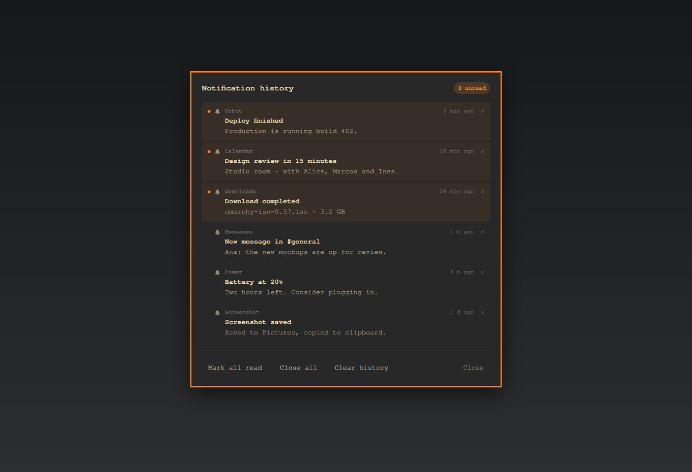

# Notification History for Omarchy

Keeps the notifications Omarchy already shows, so you can read them later. A bell in
the bar tells you how many are new, and the panel lists what arrived while you were
away.



## What it does

Omarchy shows each notification once, as a small card, and then it is gone. This
plugin keeps that history in reach:

- a **bell in the bar** with a count of notifications you have not read yet;
- a **panel under the bell** listing the most recent ones, newest first;
- **one click on a row** to go back to where the notification came from;
- **right click** to silence notifications for a while.

Everything stays on your computer. The plugin reads the history Omarchy itself
writes and never sends anything over the network.

## Install

```sh
omarchy plugin add https://github.com/GaboEI/omarchy-notification-center --enable
```

The bell appears at the right of the bar. If you prefer to install by hand, copy
this folder to `~/.config/omarchy/plugins/gabodev.notification-center/`, then run:

```sh
omarchy-shell shell rescanPlugins
omarchy plugin enable gabodev.notification-center --section right
```

Requires Omarchy 0.56 or newer. Tested on 0.56.2.

## Use

| Do this | You get |
|---|---|
| **Left click** the bell | Opens the notification panel under the bell |
| **Right click** the bell | Turns Do Not Disturb on or off |
| **`SUPER + ALT + N`** | Opens the panel from the keyboard |
| **Click a row** | Opens or focuses the app the notification came from |
| **Click the × on a row** | Removes that entry from the panel |
| **`Esc`**, or click outside | Closes the panel |

You can drag the bell anywhere on the bar. The panel always opens underneath it, and
slides sideways if the bell is close to the edge of the screen.

## The buttons

| Button | What it does |
|---|---|
| **Mark all read** | The count on the bell goes back to zero |
| **Close all** | Removes every entry from the panel and dismisses any notification still on screen |
| **Clear history** | Empties the panel so it starts fresh |
| **Close** | Closes the panel without changing anything |

**Mark all read**, **Close all** and **Clear history** also close the panel, because
you are done with the list after pressing them.

One honest detail: **Clear history** empties *this panel*, not Omarchy's own copy of
the notifications. Omarchy writes that history itself and does not offer a way to
erase it, so the plugin keeps its own small list of what you have hidden and shows
you the rest. Nothing is deleted from your disk behind your back.

## Do Not Disturb

Right click the bell and it turns into a **red bell with a line through it**. From
then on Omarchy stops showing notification cards; they go straight into the history
instead, so you can read them when you are ready. Right click again to turn it back
on.

The plugin follows Omarchy's own rules here. A few system notices — Omarchy's own
action prompts, critical alerts, and verification codes — still come through by
design, so you do not miss something urgent.

## How it works

Omarchy's notification service writes each notification it shows to a small file in
your home folder. The plugin reads that file and draws it as a list.

The panel is an ordinary window, so it never blocks anything. If you close it, the
plugin remembers only what you have read or hidden, in one small file of its own:

```
~/.config/omarchy/gabodev.notification-center/config.json
```

It contains three things: when you last read the list, when you last cleared it, and
which entries you hid. Nothing else is stored, and your notifications are never
copied anywhere.

## Good to know

- **Clicking a row does its best, and tells you when it cannot.** Some notifications
  carry an action — a screenshot to open, a file to view — and those open exactly.
  For chat apps such as Discord, Telegram or WhatsApp, the notification is gone by
  the time it reaches the history, so the exact message cannot be reopened: the
  plugin focuses the app if it is open, or opens it if it is not. When it cannot do
  either, the panel stays open and says so, instead of silently doing nothing.
- **The count is per notification**, not per chat: three messages from the same group
  count as three.
- **The list holds the most recent 100 notifications**, which is what Omarchy keeps.
- **The panel follows your desktop language.** Spanish and English are included.
- **Do Not Disturb is Omarchy's**, so the bell stays in sync if you change it
  anywhere else.

## Uninstall

```sh
omarchy plugin disable gabodev.notification-center
omarchy plugin remove gabodev.notification-center --yes
```

To discard the saved settings as well:

```sh
rm -rf ~/.config/omarchy/gabodev.notification-center
```

## License

MIT. See [LICENSE](LICENSE).
